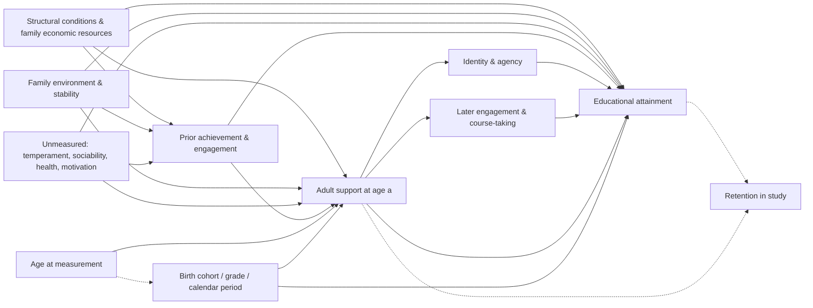

# Causal framework

Status: draft v0.1. The diagram encodes assumptions, not findings. Its purpose is to make explicit
which adjustment sets are defensible and which questions observational data cannot answer.

## Estimand for paper 1 (descriptive-causal hybrid)

Let `S_a` be a verified indicator or scale of supportive adult relationships observed at age `a`,
`Y` educational attainment in early adulthood, `L_a` pre-exposure covariates measured at or before
`a`. The primary estimand is the **age-specific conditional association**

    θ(a) = E[Y | S_a = 1, L_a, A = a] − E[Y | S_a = 0, L_a, A = a]   (averaged over L_a)

and the contrast `θ(a1) − θ(a2)` across ages. θ(a) equals the causal effect of support at age `a`
only if `L_a` blocks all back-door paths (no unmeasured confounding), there is no selection by
attrition related to `Y` given `L_a`, and measurement of `S` is comparable across `a`. We do not
expect these to hold fully, so θ(a) is reported as an association with sensitivity analyses.

## Directed acyclic graph

(The same graph in DOT form is in `causal_dag.dot` for tools such as DAGitty.)

## Threats and how each is handled

| Threat | Mechanism | Handling in the plan | Residual concern |
|---|---|---|---|
| Confounding by family resources | SES affects both access to supportive adults and attainment | Adjust for pre-exposure income/poverty, parent education, household structure | Measured with error; residual confounding likely |
| Selection on the young person (reverse causation) | Engaged, high-achieving youth attract and keep mentors and teachers' attention | Adjust for *pre-exposure* achievement and engagement; never adjust for post-exposure values | Unmeasured `U` (sociability) — E-values; negative-control outcomes if available |
| Time-varying confounding | Engagement at t affects support at t+1 and is itself affected by support at t | If repeated exposure is analysed, use g-methods (inverse-probability-weighted marginal structural models) rather than conditioning on intermediate engagement | Requires correct exposure models and positivity |
| Age–cohort–period confounding | In single-cohort studies with a range of baseline ages, age at baseline is collinear with birth year and grade | Adjust for grade where possible; report that age effects are identified only under the assumption of no cohort differences within a ~5-year birth window | Not testable within one cohort |
| Measurement non-comparability across ages | Items may be asked differently at different ages, or mean different things to a 12- and 17-year-old | Use only identically worded items for timing contrasts; test measurement invariance for multi-item scales | Invariance tests have limited power |
| Retrospective onset reports | "How old were you when this relationship began?" reported years later | Treat onset analyses as secondary; consider recall-error sensitivity analyses | Survivorship: only relationships remembered as important are reported |
| Attrition | Leaving the study may depend on outcomes | Survey weights that adjust for nonresponse; multiple imputation; bounds | MNAR cannot be excluded |
| Mediator adjustment | Adjusting for identity/engagement measured after support would remove part of the effect | Total-effect models exclude post-exposure mediators | — |
| Multiple comparisons | Many outcomes × ages × subgroups | One primary contrast; Holm for the small confirmatory family; FDR for exploratory | — |

## What would support causal claims

- **Randomised mentoring trials** that enrol across ages and report effects by age (see
  `literature_review.md`; most trials are not powered for age moderation).
- **Quasi-experiments** that move the *age at exposure* for reasons unrelated to the young person,
  such as age-at-move designs in housing-mobility research.
- Within a cohort, **within-person** comparisons (fixed-effects) can remove stable unmeasured
  confounding for time-varying outcomes, but attainment is measured once, which limits this.

The observational analyses in this project therefore primarily generate and sharpen hypotheses about
timing (concepts A and D), and their implications for intervention design are stated with that limit.
